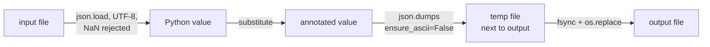

# Nested JSON annotator

A small command-line tool and Python function that replaces every leaf value in
a JSON document with a record of the value and its Python type:

```json
{"_content": 30, "_type": "<class 'int'>"}
```

Objects are walked recursively and an optional depth limit controls how many
object levels are annotated. It started as a short coding exercise and is kept
deliberately small: one pure function, one CLI module, no runtime dependencies.

## Install

Python 3.12 or newer (`.python-version` pins 3.13 for development).

```sh
python3 -m venv .venv
. .venv/bin/activate
pip install .
```

This installs the `nested-json-annotator` command. `python -m nested_json_annotator`
does the same thing.

## Usage

```text
$ nested-json-annotator --help
usage: nested-json-annotator [-h] [--version] input [max_depth] output

Replace every leaf value of a JSON document with
  {"_content": value, "_type": "<class '...'>"}
recursing into nested objects.

positional arguments:
  input       JSON file to read (UTF-8)
  max_depth   number of object levels to annotate; omit for unlimited, 0
              copies objects unchanged
  output      file to write; replaced only on success

options:
  -h, --help  show this help message and exit
  --version   show program's version number and exit

examples:
  nested-json-annotator input.json output.json      annotate every level
  nested-json-annotator input.json 1 output.json    annotate top-level keys only

Lists are leaves: their items are not visited. The output file is replaced
atomically, so a failed run never leaves a truncated or half-written file.
```

The argument order `INPUT [MAX_DEPTH] OUTPUT` comes from the original task.

### Every level

`examples/input.json` holds a fictional person record. Annotating it fully
(output pretty-printed here; the tool writes compact JSON):

```text
$ nested-json-annotator examples/input.json /tmp/full.json
$ python -m json.tool /tmp/full.json
```

```json
{
  "name": {"_content": "John Doe", "_type": "<class 'str'>"},
  "age": {"_content": 30, "_type": "<class 'int'>"},
  "isMarried": {"_content": false, "_type": "<class 'bool'>"},
  "hobbies": {
    "_content": ["reading", "traveling", "photography"],
    "_type": "<class 'list'>"
  },
  "address": {
    "street": {"_content": "123 Main St", "_type": "<class 'str'>"},
    "city": {"_content": "Anytown", "_type": "<class 'str'>"},
    "state": {"_content": "CA", "_type": "<class 'str'>"},
    "zip": {"_content": "12345", "_type": "<class 'str'>"}
  }
}
```

`examples/output.json` is this result, and a test checks that they match.

### Limited depth

With a depth of `1`, top-level values are annotated and the `address` object
is copied as it is:

```text
$ nested-json-annotator examples/input.json 1 /tmp/depth1.json
$ cat /tmp/depth1.json
{"name": {"_content": "John Doe", "_type": "<class 'str'>"}, "age": {"_content": 30, "_type": "<class 'int'>"}, "isMarried": {"_content": false, "_type": "<class 'bool'>"}, "hobbies": {"_content": ["reading", "traveling", "photography"], "_type": "<class 'list'>"}, "address": {"street": "123 Main St", "city": "Anytown", "state": "CA", "zip": "12345"}}
```

| Depth | `{"a": 1, "b": {"c": 2}}` becomes |
| --- | --- |
| `0` | unchanged |
| `1` | `a` wrapped, `b.c` left as `2` |
| `2` or omitted | `a` and `b.c` wrapped |

### Errors

Errors go to stderr with exit status 1 (2 for bad arguments), and an existing
output file is left as it was:

```text
$ printf '{"a": 1' > /tmp/bad.json
$ echo keep > /tmp/out.json
$ nested-json-annotator /tmp/bad.json /tmp/out.json
nested-json-annotator: error: invalid JSON in /tmp/bad.json: Expecting ',' delimiter: line 1 column 8 (char 7)
$ cat /tmp/out.json
keep

$ nested-json-annotator nope.json /tmp/out.json
nested-json-annotator: error: input file not found: nope.json

$ nested-json-annotator examples/input.json -2 /tmp/out.json
usage: nested-json-annotator [-h] [--version] input [max_depth] output
nested-json-annotator: error: argument max_depth: must be non-negative, got -2
```

## Python API

```python
from nested_json_annotator import substitute

source = {"metrics": {"count": 3}, "tags": ["a"]}
substitute(source)
# {'metrics': {'count': {'_content': 3, '_type': "<class 'int'>"}},
#  'tags': {'_content': ['a'], '_type': "<class 'list'>"}}
substitute(source, depth=1)
# {'metrics': {'count': 3}, 'tags': {'_content': ['a'], '_type': "<class 'list'>"}}
```

`substitute(value, depth=None)` raises `ValueError` for a negative depth.

## How it works



Design choices worth knowing:

- **Only objects are walked.** Lists, including lists of objects, are leaves
  and are wrapped whole. This matches the original task.
- **Type names are Python's**, e.g. `<class 'NoneType'>` for `null`, not JSON
  Schema types. A scalar root is wrapped at any depth.
- **Objects are rebuilt, not mutated.** Values that are not visited (leaf lists,
  objects below the depth limit) are shared with the input; this is not a deep
  copy.
- **Not idempotent.** Running the tool on its own output wraps the metadata
  again.
- **Atomic output.** The result is fully rendered in memory, written to a
  temporary file in the output's directory, flushed and renamed over the target,
  keeping an existing file's permissions. Reading and writing the same file is
  safe.
- **Strict JSON.** `NaN`/`Infinity`, numbers that overflow a float, a UTF-8 BOM
  and invalid UTF-8 are reported as errors. Non-ASCII text is written unescaped.
- **Limits.** The whole document is held in memory. Nesting deeper than Python's
  recursion limit (about 1000 levels) is reported as an error rather than
  crashing.

## Development

```sh
pip install -r requirements-dev.txt
python -m pytest -q
ruff check . && ruff format --check .
```

The 45 tests cover leaf types, depth boundaries, lists, deep nesting, Unicode,
invalid and oversized input, argument errors and overwrite safety. pytest is
configured to import from `src/`, so the tests run without installing the
package.

## License

MIT, see [LICENSE](LICENSE).
